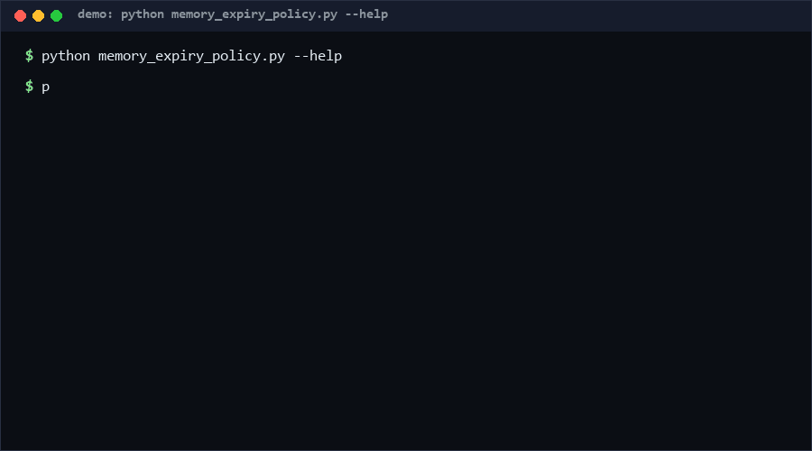

# memory-expiry-policy

A declarative policy language and checker for expiring agent memories. You
declare TTLs and expiry verbs (`soft_delete`, `hard_delete`, `demote`) as JSON
rules matched on record attributes; the tool validates the policy, applies it
to a memory store, and emits a purge audit trail. Pure standard library, one
file, no daemon. *No direct equivalent found as of 2026-10-13.*

<p align="center"></p>

## Problem

Agent memory stores grow forever because expiry is ad hoc: some code paths
delete, some demote, some forget entirely. There is no declarative place that
answers "when does a memory of kind X expire, and what happens to it?". The
result is silent divergence between intended retention and actual retention,
and no audit trail for purges — a compliance problem the moment memories
contain user data.

## How it works

A **policy** is a JSON document: `default_ttl`, `fallback_on_expiry`, and an
ordered list of rules. Each rule has a `match` object (exact attribute
equality), a `ttl` (`30d`, `12h`, `45m`, `0s`, or `never`), and an
`on_expiry` verb. First matching rule wins; unmatched records fall back to
`default_ttl` + `fallback_on_expiry`.

- **soft_delete** — keep the record, flag it `expired: true` (recoverable).
- **hard_delete** — drop it from the store entirely.
- **demote** — keep it but flag `demoted: true` (cheap retrieval, excluded
  from prompts by the consumer).

`validate` checks policy structure (rules R1–R10). `simulate` applies the
policy to a store at a given `--now` and returns per-record actions plus an
audit array; it never mutates its input.

## Quickstart

```console
$ python memory_expiry_policy.py simulate store.json policy.json --now 2026-10-13T00:00:00Z
m000001 -> hard_delete (rule:id=r1)
m000002 -> demote (rule:id=r2)
...
kept=6412 audit=3588
```

Validating a policy takes well under a second; simulating 10k records took
0.030s [Measured] on the reference machine (see Performance).

## Why not X

No tool with the same scope surfaced during research (checked 2026-10-13),
but adjacent solutions exist:

- **Redis / Memcached key TTL** — TTLs live in the storage engine, keyed per
  entry with a single hard-expiry verb. No declarative rule matching, no
  demote semantics, no audit trail, and policy is invisible to consumers.
- **LLM agent frameworks' memory managers** (e.g. LangChain memory classes)
  — trimming is procedural and framework-locked; there is no standalone,
  storage-agnostic policy artifact you can version, lint, or audit.
- **GDPR retention scripts** — usually bespoke cron jobs; nothing validates
  the retention declaration itself or separates the three expiry verbs.
- **JSON Schema** — validates document shape, not temporal semantics
  (expiry decisioning) or audit generation.

## Performance

All numbers [Measured] locally (Python 3.13, Windows 10, single core):

| Workload | Result | Command |
|---|---|---|
| 10,000-record store, 2 rules | 0.030s (332k rec/s) | `python memory_expiry_policy.py bench --records 10000` |
| Policy validation | <1ms | `python memory_expiry_policy.py validate policy.json` |

`bench` uses a fixed seed, so the workload mix (secret/summary/note) is
reproducible.

## Minimal Fallback

If this tool is unavailable, the minimal equivalent is a five-line grep-able
table in your repo: `kind,ttl,verb` lines plus a code comment pointing at the
one function that reads them. You lose validation, first-match-wins
guarantees, and the audit trail — document that in the header comment.

## Design Trade-offs

- **Exact-match rules only.** No regex/glob matching: keeps the policy
  auditable by humans and the simulator deterministic. Iterate rules if you
  need grouping.
- **Expiry based on `created_at`, not `last_access`.** Time-based decay from
  creation is predictable and testable; access-based TTL needs write access
  to records on every read.
- **Flag-in-place over separate index.** `demote`/`soft_delete` mutate a copy
  of the record instead of maintaining a side table — consumers see state
  atomically, at the cost of one extra JSON field.
- **First match wins.** Simple mental model; overlapping rules are resolved
  by order, not by error.

## Limits & Second-order Effects

- The simulator is offline: it does not enforce anything in a live store; a
  consumer must apply the returned actions.
- Demoted memories still occupy storage; only `hard_delete` reclaims it.
- An over-broad default `fallback_on_expiry=hard_delete` is destructive by
  construction — validation allows it, your review should not.
- Audit log growth mirrors purge volume; `audit.retention` is declared but
  enforcement belongs to your log pipeline.

## FAQ

**When NOT to use this?** Do not use it as a real-time eviction engine for
large caches (use the storage engine's TTL); as a substitute for legal
records-retention workflows (talk to counsel); or when records need
per-record TTL overrides set at write time (declare more rules instead).

**Why JSON and not YAML?** Pure stdlib; JSON keeps the dependency tree empty.

**Is `never` safe?** It is explicit in the policy file, so the decision is
reviewable — that is the point.

**Can rules overlap?** Yes; first match wins. Prefer disjoint `match` sets.

## [Core Assumptions]

1. Records carry an `id` and a `created_at` timestamp; stores without these
   are out of scope.
2. Expiry decisions are pure functions of (record, policy, now) — no I/O,
   no clocks other than the provided `--now`.
3. Consumers (the agent runtime) honor `expired`/`demoted` flags; this
   project defines the contract, not the enforcement.
4. Policy files are small (<100 rules) and human-reviewed.

Confidence: high in the validator and simulator behavior (fully covered by
self_test.py); medium that three verbs cover real retention needs — the verb
set is extensible by design. As of 2026-10-13.

---

Part of the [zhengming-toolbox](https://github.com/chenhz01/zhengming-toolbox) — 105 purpose-built AI-engineering tools across neglected niches.

Related tools: [instruction-conflict-detector](https://github.com/chenhz01/instruction-conflict-detector) · [llm-error-code-spec](https://github.com/chenhz01/llm-error-code-spec) · [context-truncation-bench](https://github.com/chenhz01/context-truncation-bench)
